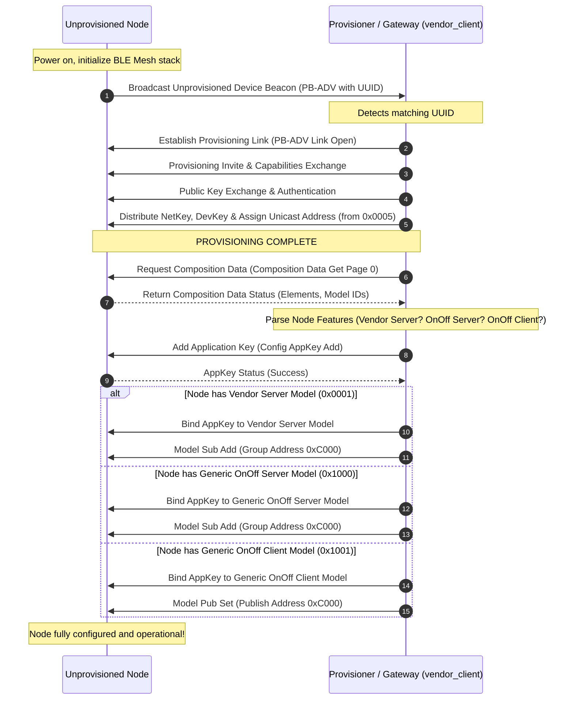
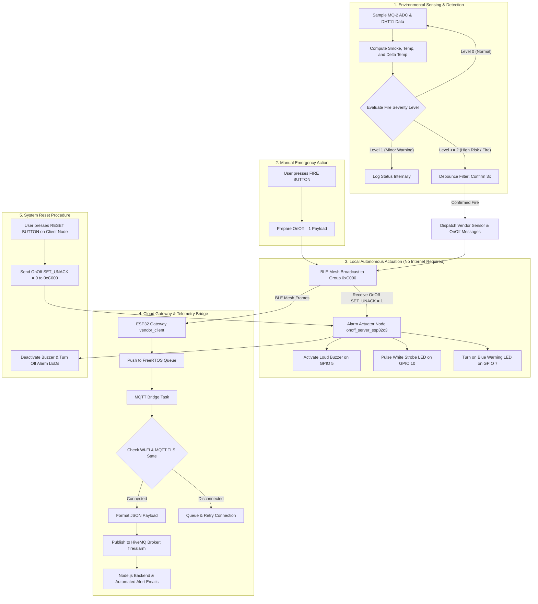
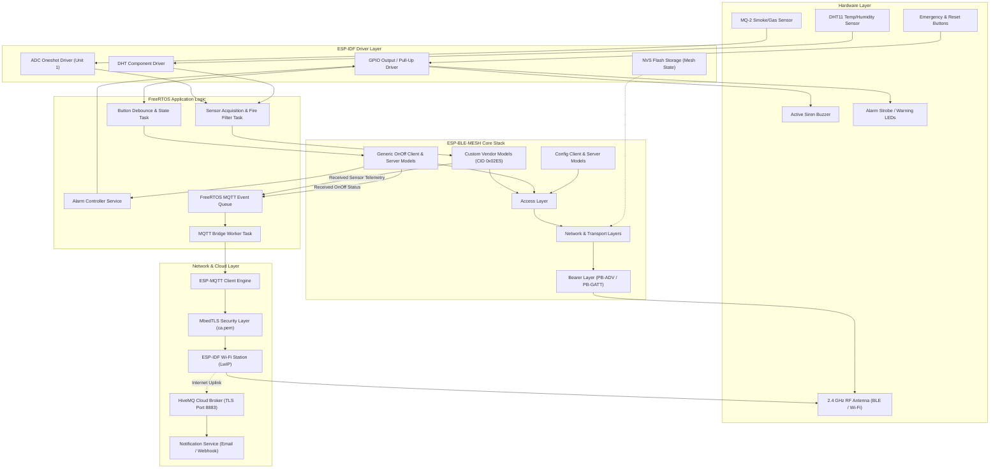

# BLE Mesh-Based Fire Alarm and Sensor Monitoring System
> **Distributed Fire Detection & Emergency Alerting Network over Bluetooth Low Energy Mesh**  
> *Course Project: Wireless Sensor Networks & Embedded Systems — University of Information Technology (UIT, VNU-HCM)*

---

## Table of Contents
1. [Overview](#1-overview)
2. [Key Features](#2-key-features)
3. [System Architecture](#3-system-architecture)
4. [Operational Flowcharts & Sequence Diagrams](#4-operational-flowcharts--sequence-diagrams)
5. [Component Diagram](#5-component-diagram)
6. [Technical Specifications & Packet Formats](#6-technical-specifications--packet-formats)
7. [Technologies Used](#7-technologies-used)
8. [Installation & Usage Guide](#8-installation--usage-guide)
9. [Limitations & Future Improvements](#9-limitations--future-improvements)
10. [Project Directory Structure](#10-project-directory-structure)
11. [Project Context](#11-project-context)
---

## 1. Overview

The **BLE Mesh-Based Fire Alarm and Sensor Monitoring System** is an early fire warning and decentralized environmental monitoring solution built on **ESP32** and **ESP32-C3** microcontrollers. It leverages **Bluetooth Low Energy (BLE) Mesh** networking paired with an **IoT Gateway (Wi-Fi + MQTT)**.

### Background & Motivation
- **Local Network Resilience:** In real-world fire scenarios, internet connections, cellular backhauls, and local Wi-Fi infrastructures are frequently severed or destroyed first. This system is designed so that **the local fire alarm and safety response operates completely independent of internet connectivity**: sensor nodes, manual call points, and siren/alarm strobe nodes communicate via a resilient, multi-hop peer-to-peer BLE Mesh network.
- **Remote Telemetry & Cloud Integration:** Concurrently, an ESP32 Gateway node (acting as both BLE Mesh Provisioner and Client) bridges local environmental telemetry (smoke concentration, temperature, humidity) and emergency events to **HiveMQ Cloud** via **MQTT over TLS/SSL**. This enables real-time central dashboard monitoring, incident logging, and automated notifications (Email/SMS).
- **Prototyping Scope:** The prototype consists of **7 ESP32 / ESP32-C3 nodes** fulfilling all vital roles: Network Provisioner, Cloud Gateway, Environmental Sensing, Manual Emergency Stations, and Audible/Visual Alarm Siren Nodes.

---

## 2. Key Features

### 2.1. Distributed Mesh Networking (BLE Mesh)
- **Automated Provisioning & Configuration:** The Provisioner discovers unprovisioned nodes via PB-ADV beacons, generates and distributes network keys (NetKey) and application keys (AppKey), and automatically assigns unicast addresses starting from `0x0005`.
- **Group Multicast Publish/Subscribe:** Pre-configured group multicast address (`0xC000`) for both telemetry (Vendor Model) and alarm synchronization (Generic OnOff Model), allowing instant broadcast without unicast polling overhead.
- **Self-Healing & Range Extension:** Relay feature enabled on designated nodes to repeat packets across physical obstacles and expand coverage across large facilities.

### 2.2. Multi-Parametric Sensing & Multi-Tier Fire Evaluation
- **Dual Sensor Acquisition:** Integrates an **MQ-2** gas/smoke sensor (via 12-bit ADC1, 12dB attenuation) with a digital **DHT11** temperature and humidity sensor.
- **Hierarchical Fire Assessment (4 Levels):**
  - **Level 0 (NORMAL):** Baseline environmental parameters.
  - **Level 1 (WARNING):** Minor smoke detected (`MQ2 > 1500`).
  - **Level 2 (HIGH RISK):** Elevated threat level (`MQ2 > 2500` or temperature $T > 36^\circ\text{C}$).
  - **Level 3 (FIRE CONFIRMED):** Verified fire state combining dense smoke and rapid thermal rise (`MQ2 > 3000` combined with $T > 40^\circ\text{C}$ or rate-of-rise $\Delta T > 1.5^\circ\text{C}$).
- **False Alarm Suppression:** Implements a consecutive state debouncing filter (`FIRE_CONFIRM_CNT = 3`) before committing a state change.

### 2.3. Distributed Siren & Strobe Actuation (SIG Generic OnOff)
- **Standardized Generic OnOff Model:** Employs standard Bluetooth SIG models (`GEN_ONOFF_CLI` and `GEN_ONOFF_SRV`) for buzzer and LED strobe actuation.
- **Autonomous Triggering:** When sensor nodes detect `fire_level >= 2`, an unacknowledged set message (`GEN_ONOFF_SET_UNACK` with `onoff = 1`) is broadcast to group `0xC000`.
- **Manual Emergency Call Point & Reset:** Equipped with a dedicated **FIRE Button** for immediate manual activation and a **RESET Button** to silence sirens and restore normal operation once cleared.

### 2.4. Custom Telemetry Model (Custom Vendor Models)
- Proprietary Vendor Model defined under Espressif's Company ID (`CID_ESP = 0x02E5`):
  - Server Model ID: `0x0001`
  - Client Model ID: `0x0002`
- Compact binary payload (`fire_msg_t`, 8 bytes) containing command opcode, raw MQ-2 ADC, scaled temperature ($T \times 10$), scaled humidity ($H \times 10$), and fire severity level.
- Flexible operational modes: Event-driven alerts and query-response polling (`cmd = 0x10`).

### 2.5. Cloud IoT Gateway Bridge (Wi-Fi + MQTT TLS)
- The `vendor_client` node runs **BLE Mesh + Wi-Fi Station + FreeRTOS Queue** concurrently.
- Translates binary BLE Mesh status frames into standard JSON payloads:
  ```json
  {"mq2": 2650, "temp": 38.5, "humi": 62.0, "fire": 2}
  ```
  or
  ```json
  {"onoff": 1}
  ```
- Secure **TLS v1.2/1.3** uplink to **HiveMQ Cloud Broker** (Port 8883) verified against an embedded Root CA certificate (`ca.pem`).
- Decoupled FreeRTOS queue architecture prevents mesh latency or packet loss during network retries.

### 2.6. Low-Power Node (LPN) & Friend Exploration
- Evaluates BLE Mesh Low Power Node (LPN) polling against Friend nodes.
- Friend nodes buffer incoming messages while the LPN sleeps, allowing periodic poll retrieval for battery-constrained sensor deployments.

---

## 3. System Architecture

The architecture is organized into a three-tier model:

```
+-----------------------------------------------------------------------------+
|                         TIER 3: CLOUD & REMOTE SERVICES                     |
|           +-----------------------+     +-----------------------+           |
|           |     HiveMQ Cloud      |     |  Backend Notification |           |
|           |    (MQTT over TLS)    |<--->| (Node.js / SMTP Alert)|           |
|           +-----------^-----------+     +-----------------------+           |
+-----------------------|-----------------------------------------------------+
                        | Wi-Fi (WPA2 + TLS)
+-----------------------v-----------------------------------------------------+
|                      TIER 2: IOT GATEWAY & PROVISIONER                      |
|    +-------------------------------------------------------------------+    |
|    | ESP32 GATEWAY (vendor_client)                                     |    |
|    | - Mesh Provisioner & Config Client                                |    |
|    | - Vendor Client Model & Generic OnOff Client                      |    |
|    | - Wi-Fi Station + MQTT Client (TLS ca.pem) + FreeRTOS Queue Bridge|    |
|    +---------------------------------^---------------------------------+    |
+--------------------------------------|--------------------------------------+
                                       | BLE Mesh Network (2.4GHz RF)
                                       | Group Multicast: 0xC000
+--------------------------------------v--------------------------------------+
|             TIER 1: LOCAL BLE MESH SENSING & ALARM ACTUATION                |
|                                                                             |
|   +-----------------------+  +-----------------------+  +-----------------+ |
|   | SENSOR NODE (ESP32)   |  | EMERGENCY NODE (C3)   |  | ALARM NODE (C3) | |
|   | (vendor_server)       |  | (onoff_client_esp32c3)|  | (onoff_server)  | |
|   | - MQ-2 Smoke/Gas ADC  |  | - Fire Push Button    |  | - Loud Buzzer   | |
|   | - DHT11 Temp & Humi   |  | - Reset Push Button   |  | - Strobe White  | |
|   | - Vendor Server Model |  | - Gen OnOff Client    |  |   & Blue LEDs   | |
|   | - Fire State Engine   |  | - Indicator LED       |  | - Gen OnOff Srv | |
|   +-----------------------+  +-----------------------+  +-----------------+ |
|                                                                             |
|   +-----------------------+  +-----------------------+                      |
|   | STANDALONE SENSOR (32)|  | DEDICATED PROV (32)   |                      |
|   | (onoff_client_sensor) |  | (provisioner_esp32)   |                      |
|   | - Direct MQ-2 & DHT11 |  | - Standalone Admin    |                      |
|   | - Direct OnOff Client |  | - Network Config Tool |                      |
|   +-----------------------+  +-----------------------+                      |
+-----------------------------------------------------------------------------+
```

### Prototype Hardware Allocation (7-Node Setup)

| Directory / Module | Target MCU | BLE Mesh Role | Peripherals & Sensors | Protocols / Models |
| :--- | :--- | :--- | :--- | :--- |
| **`vendor_client`** | ESP32-WROOM-32 | **Provisioner + Gateway** | Push buttons: Vendor (GPIO26), OnOff (GPIO25) | BLE Mesh Vendor Client, OnOff Client, Wi-Fi Station, MQTT TLS |
| **`vendor_server`** | ESP32-WROOM-32 | **Sensor Node** | MQ-2 (ADC1_CH6 - GPIO34), DHT11 (GPIO25), Buzzer (GPIO22), LEDs (GPIO21, 19) | BLE Mesh Vendor Server, Config Server |
| **`onoff_server_esp32c3`** | ESP32-C3 DevKit | **Alarm Actuator Node** | Buzzer (GPIO5), White Strobe LED (GPIO10), Blue Alert LED (GPIO7) | Generic OnOff Server (3 Elements), Config Server |
| **`onoff_client_esp32c3`** | ESP32-C3 DevKit | **Emergency Station** | FIRE Button (GPIO20), RESET Button (GPIO21), Indicator LED (GPIO8) | Generic OnOff Client, Config Server |
| **`onoff_client_esp32_sensor`** | ESP32-WROOM-32 | **Direct Sensor Node** | MQ-2 (GPIO34), DHT11 (GPIO25) | Generic OnOff Client (Direct broadcast on alarm) |
| **`provisioner_esp32`** | ESP32-WROOM-32 | **Standalone Provisioner** | Standalone maintenance/commissioning node | BLE Mesh Provisioner, Config Client, OnOff Client |

---

## 4. Operational Flowcharts & Sequence Diagrams

### 4.1. Node Commissioning & Configuration Flow (Sequence Diagram)

Automated provisioning, composition parsing, key binding, and group subscription:



---

### 4.2. Runtime Telemetry, Alarm Actuation & Cloud Forwarding (Flowchart)

Parallel execution showing local autonomous alarm tripping and cloud bridge forwarding:



---

## 5. Component Diagram

Visual breakdown of hardware components, firmware layers, network abstractions, and cloud services:



---

## 6. Technical Specifications & Packet Formats

### 6.1. Custom Vendor Payload Structure (`fire_msg_t`)
Packed binary structure designed to fit inside a single unsegmented BLE Mesh Advertising packet:

```c
typedef struct __attribute__((packed)) {
    uint8_t  cmd;         // 0x01: Sensor Data / Fire Alert; 0x10: State Query (Polling)
    uint16_t mq2_adc;     // Raw 12-bit ADC value from MQ-2 (0 to 4095)
    int16_t  temp_x10;    // Temperature scaled by 10 (e.g. 365 = 36.5 deg C)
    int16_t  humi_x10;    // Relative humidity scaled by 10 (e.g. 650 = 65.0 %)
    uint8_t  fire_level;  // 0: Normal, 1: Warning, 2: High Risk, 3: Fire Confirmed
} fire_msg_t;
```

#### Vendor Model Opcodes (Company ID: `0x02E5`)
| Opcode Name | Encoded Value | Direction | Purpose |
| :--- | :--- | :--- | :--- |
| `ESP_BLE_MESH_VND_MODEL_OP_SEND` | `0xC002E5` | Client $\rightarrow$ Server | Request sensor status or transmit configuration commands |
| `ESP_BLE_MESH_VND_MODEL_OP_STATUS` | `0xC102E5` | Server $\rightarrow$ Client | Transmit telemetry response or emergency fire broadcast |

### 6.2. GPIO Pinout & Peripheral Assignment

#### Environmental Sensor Node (`vendor_server` — ESP32 WROOM)
| Peripheral | Sensor / Board Pin | ESP32 Pin | Mode | Description |
| :--- | :--- | :--- | :--- | :--- |
| **MQ-2 Gas Sensor** | Analog Pin (A0) | **GPIO 34** | ADC1 Channel 6 (12dB) | Samples gas/smoke density |
| **DHT11 Sensor** | Data Pin | **GPIO 25** | Digital Open-Drain | Samples temperature and humidity |
| **Local Buzzer** | Signal Pin | **GPIO 22** | Output (Active High) | Onboard alarm buzzer |
| **White Alert LED** | Anode (+) | **GPIO 21** | Output | Visual alert indicator |
| **Blue Status LED** | Anode (+) | **GPIO 19** | Output | Heartbeat indicator |

#### Alarm Actuator Node (`onoff_server_esp32c3` — ESP32-C3)
| Peripheral | Board Pin | ESP32-C3 Pin | Mode | Description |
| :--- | :--- | :--- | :--- | :--- |
| **Loud Alarm Buzzer**| Control Pin | **GPIO 5** | Output (Active High) | Main evacuation alarm sounder |
| **White Strobe LED** | Anode (+) | **GPIO 10** | Output | High-visibility emergency strobe |
| **Blue Warning LED** | Anode (+) | **GPIO 7** | Output | Visual evacuation guide |

#### Emergency Call Point Station (`onoff_client_esp32c3` — ESP32-C3)
| Peripheral | Board Pin | ESP32-C3 Pin | Mode | Description |
| :--- | :--- | :--- | :--- | :--- |
| **FIRE Button** | Switch Terminal | **GPIO 20** | Input (Internal Pull-Up) | Triggers emergency alarm (`onoff = 1`) |
| **RESET Button** | Switch Terminal | **GPIO 21** | Input (Internal Pull-Up) | Clears active alarm (`onoff = 0`) |
| **Status Indicator**| Anode (+) | **GPIO 8** | Output | Acknowledges button interaction |

#### Gateway & Provisioner (`vendor_client` — ESP32 WROOM)
| Peripheral | Switch Terminal | ESP32 Pin | Mode | Description |
| :--- | :--- | :--- | :--- | :--- |
| **Vendor Test Button**| Switch Terminal | **GPIO 26** | Input (Pull-Up) | Triggers vendor polling / gate check |
| **OnOff Test Button** | Switch Terminal | **GPIO 25** | Input (Pull-Up) | Triggers manual OnOff broadcast to `0xC000` |

---

## 7. Technologies Used

### 7.1. Hardware
- **Microcontrollers:**
  - **ESP32-WROOM-32:** Xtensa Dual-Core 32-bit LX6, up to 240MHz, 520KB SRAM, 2.4GHz Wi-Fi + Bluetooth v4.2/BLE.
  - **ESP32-C3 DevKit:** RISC-V 32-bit single-core, up to 160MHz, 400KB SRAM, Bluetooth 5 (LE) / BLE Mesh.
- **Sensors:** MQ-2 Gas/Smoke Sensor, DHT11 Temperature & Humidity Sensor.
- **Actuators:** Active Buzzers ($\ge 85\text{dB}$ output), high-intensity alarm LEDs, mechanical momentary switches with debounce logic.

### 7.2. Embedded Platforms & Operating System
- **RTOS:** FreeRTOS Kernel (Task Scheduling, Queues, Software Timers, Semaphores).
- **Development Framework:** **Espressif IoT Development Framework (ESP-IDF)** v5.1 / v5.2.
- **Peripheral Drivers:** ESP-IDF ADC Oneshot API, GPIO driver, NVS Flash Key-Value storage.
- **Components:** `esp-idf-lib/dht` (DHT11/AM2301 driver component).
- **Language:** Embedded C (C99/C11 standards).

### 7.3. Wireless Networking & IoT Protocols
- **Bluetooth Low Energy (BLE) Mesh v1.0.1:**
  - Bearer: PB-ADV (Advertising Bearer), PB-GATT.
  - SIG Standard Models: Generic OnOff Server/Client (`0x1000`/`0x1001`), Configuration Server/Client.
  - Custom Vendor Models: Company Identifier `0x02E5` (Espressif).
  - Node Features: Provisioner, Relay, Friend, Low Power Node (LPN).
- **Wi-Fi & Cloud Transport:**
  - Wi-Fi Station Mode (802.11 b/g/n, WPA2-PSK).
  - Transport Layer Security: **TLS v1.2 / TLS v1.3** via MbedTLS.
  - Messaging Protocol: **MQTT v3.1.1** (QoS 0/1).
  - Data Serialization: JSON.

### 7.4. Cloud Infrastructure & Notification Services
- **Cloud MQTT Broker:** **HiveMQ Cloud** (Managed serverless cluster on Port 8883 over TLS).
- **Notification Microservice:** Node.js Backend with Nodemailer integration for automated emergency alert emails.

---

## 8. Installation & Usage Guide

### 8.1. Prerequisites
- Operating System: **Linux (Ubuntu 20.04/22.04 LTS recommended)**, macOS, or Windows (WSL2).
- Installed **ESP-IDF** (recommended version: `v5.1` or `v5.2`).
- Python 3.8+, CMake, Ninja build system, and Git.
- USB-to-UART cables for ESP32 and ESP32-C3 boards.

Verify that your ESP-IDF environment is active:
```bash
idf.py --version
# Expected output: ESP-IDF v5.1.x or v5.2.x
```

---

### 8.2. Cloud Certificate & Credential Setup (Gateway Node)
1. Download the Root CA certificate for your HiveMQ Cloud cluster.
2. Save it as `ca.pem` inside `vendor_client/main/cert/`:
   ```bash
   cp /path/to/your/hivemq-ca.pem vendor_client/main/cert/ca.pem
   ```
3. Edit [vendor_client/main/main.c](file:///tmp/BLE_MESH/vendor_client/main/main.c) with your Wi-Fi and HiveMQ Cloud credentials:
   ```c
   static const char *MQTT_URI  = "mqtts://your-cluster-url.hivemq.cloud:8883";
   static const char *MQTT_USER = "your_mqtt_username";
   static const char *MQTT_PASS = "your_mqtt_password";

   #define WIFI_SSID "Your_WiFi_SSID"
   #define WIFI_PASS "Your_WiFi_Password"
   ```

---

### 8.3. Building and Flashing Firmware

> [!IMPORTANT]
> Flash the **end nodes (Servers and Emergency Clients)** first. Flash and start the **Gateway / Provisioner** last to ensure automatic and seamless mesh commissioning.

#### Step 1: Flash Environmental Sensor Node (`vendor_server`)
Target: **ESP32-WROOM-32**
```bash
cd vendor_server
idf.py set-target esp32
idf.py build
idf.py -p /dev/ttyUSB0 flash monitor
```

#### Step 2: Flash Alarm Actuator Node (`onoff_server_esp32c3`)
Target: **ESP32-C3**
```bash
cd ../onoff_server_esp32c3
idf.py set-target esp32c3
idf.py build
idf.py -p /dev/ttyACM0 flash monitor
```

#### Step 3: Flash Emergency Call Point Node (`onoff_client_esp32c3`)
Target: **ESP32-C3**
```bash
cd ../onoff_client_esp32c3
idf.py set-target esp32c3
idf.py build
idf.py -p /dev/ttyACM1 flash monitor
```

#### Step 4: (Optional) Flash Direct Sensor Node (`onoff_client_esp32_sensor`)
Target: **ESP32**
```bash
cd ../onoff_client_esp32_sensor
idf.py set-target esp32
idf.py build
idf.py -p /dev/ttyUSB1 flash monitor
```

#### Step 5: Flash Gateway & Provisioner (`vendor_client`)
Target: **ESP32**
```bash
cd ../vendor_client
idf.py set-target esp32
idf.py build
idf.py -p /dev/ttyUSB2 flash monitor 
```
If you use Windows, you will replace " /dev/ttyUSB2 " with " COMX "
By using device manager, on tab "Ports", you'll see the difference between plug and unplug usb on esp.
---

### 8.4. Operational Verification

1. **Observe Automatic Provisioning:**
   - Launch serial monitor on the Gateway:
     ```bash
     idf.py -p /dev/ttyUSB2 monitor
     ```
   - Watch the logs as it detects unprovisioned beacons, exchanges keys, parses composition data, binds models, and subscribes all nodes to group `0xC000`.

2. **Test Manual Emergency Evacuation:**
   - Press the **FIRE Button** (GPIO 20) on `onoff_client_esp32c3`.
   - **Expected behavior:** Sirens on all `onoff_server_esp32c3` nodes immediately sound, and white/blue alarm strobe LEDs flash synchronously.
   - Press the **RESET Button** (GPIO 21) to silence the alarm.

3. **Test Autonomous Fire Detection:**
   - Expose the MQ-2 sensor on `vendor_server` to smoke or flame.
   - Once readings exceed threshold (`fire_level >= 2`), the node automatically broadcasts an alarm to `0xC000` and reports status to the Gateway.

4. **Verify Cloud Telemetry:**
   - Connect to the HiveMQ Web Client or MQTT Dash app, subscribe to `fire/alarm`.
   - Incoming JSON telemetry will stream in real time:
     ```json
     {"mq2":2910,"temp":41.2,"humi":58.0,"fire":3}
     ```

---

## 9. Limitations & Future Improvements

### Current Limitations
1. **Sensor Precision & Warm-up Time:**
   - MQ-2 and DHT11 are introductory sensors; MQ-2 requires an initial burn-in period to stabilize and consumes significant heater current (~150-180mA).
   - DHT11 has a low sampling frequency (1Hz maximum) and moderate accuracy compared to industrial chips like SHT3x or BME280.
2. **Prototype Scale:**
   - Validated on a 7-node network in lab conditions; not yet benchmarked across multi-story concrete structures with dense RF attenuation.
3. **LPN Polling Latency:**
   - Field measurements of the Friend–LPN link demonstrated latency up to ~17 seconds when poll intervals are set high to conserve battery.
4. **Gateway RF Coexistence:**
   - Running Wi-Fi and BLE concurrently on a single ESP32 causes RF time-sharing, which can lead to marginal packet latency under heavy traffic.
5. **No-OOB Provisioning:**
   - Currently uses No-OOB authentication for rapid testing; should be replaced with Out-Of-Band (OOB) authentication (NFC/QR code) in production.

### Future Improvements
- [ ] **Industrial Sensor Upgrade:** Integrate photoelectric smoke sensors and high-precision temperature sensors (e.g., SHT35, DS18B20).
- [ ] **Dedicated Gateway Hardware:** Separate BLE Provisioner and Wi-Fi Gateway onto two dedicated chips communicating over high-speed UART/SPI to eliminate coexistence contention.
- [ ] **Enhanced Provisioning Security:** Implement Static OOB / Public Key verification via QR codes.
- [ ] **Visual 3D Floorplan Dashboard:** Build a Web/Mobile digital twin showing live node health, floorplan layout, and precise fire origination rooms.

---

## 10. Project Directory Structure

```plaintext
BLE_MESH/
├── .gitignore                          # Build artifact ignore patterns for ESP-IDF
├── README.md                           # Main English project documentation
├── README-vi_VN.md                     # Vietnamese project documentation
│
├── vendor_client/                      # Gateway & BLE Mesh Provisioner Node (ESP32)
│   ├── CMakeLists.txt                  # Top-level CMake configuration
│   ├── README.md                       # Espressif vendor client walkthrough
│   └── main/
│       ├── CMakeLists.txt              # Component registration & ca.pem embedding
│       ├── idf_component.yml           # ESP-IDF component dependencies
│       ├── board.h / board.c           # Board-specific LED and button definitions
│       ├── main.c                      # Provisioner, Vendor Client, Wi-Fi & MQTT bridge
│       └── cert/                       # TLS Certificates directory
│           ├── README.md               # Certificate placement guide
│           └── ca.pem                  # Root CA certificate for HiveMQ Cloud
│
├── vendor_server/                      # Environmental Sensor Node (ESP32)
│   ├── CMakeLists.txt                  # Top-level CMake configuration
│   ├── README.md                       # Espressif vendor server notes
│   └── main/
│       ├── CMakeLists.txt              # Component registration
│       ├── idf_component.yml           # Dependency declaration (esp-idf-lib/dht)
│       ├── Kconfig.projbuild           # Target board configuration (ESP32-WROOM-32)
│       ├── board.h / board.c           # Hardware abstractions
│       ├── sensor.h / sensor.c         # MQ-2 ADC reading, DHT11 logic, fire assessment
│       ├── alarm.h / alarm.c           # Local siren & LED control
│       └── main.c                      # Vendor Server model & measurement task loop
│
├── onoff_server_esp32c3/               # Alarm Actuator Siren/Strobe Node (ESP32-C3)
│   ├── CMakeLists.txt                  # Top-level CMake configuration
│   ├── README.md                       # Generic OnOff Server guide
│   └── main/
│       ├── CMakeLists.txt              # Component registration
│       ├── idf_component.yml           # Component dependencies
│       ├── Kconfig.projbuild           # Target board configuration (ESP32C3-DevKit)
│       ├── board.h / board.c           # LED state mapping
│       └── main.c                      # Generic OnOff Server (Buzzer GPIO 5, Strobe LEDs)
│
├── onoff_client_esp32c3/               # Emergency Call Point Station Node (ESP32-C3)
│   ├── CMakeLists.txt                  # Top-level CMake configuration
│   ├── README.md                       # Generic OnOff Client guide
│   └── main/
│       ├── CMakeLists.txt              # Component registration
│       ├── idf_component.yml           # Component dependencies
│       ├── Kconfig.projbuild           # Target board configuration (ESP32C3-DevKit)
│       ├── board.h / board.c           # Status LED helper
│       └── main.c                      # Button handler (FIRE GPIO 20, RESET GPIO 21)
│
├── onoff_client_esp32_sensor/          # Direct Sensor Alarm Node (ESP32)
│   ├── CMakeLists.txt                  # Top-level CMake configuration
│   ├── README.md                       # Documentation notes
│   └── main/
│       ├── CMakeLists.txt              # Component registration
│       ├── idf_component.yml           # Dependency on DHT library
│       ├── Kconfig.projbuild           # Target board configuration (ESP32-WROOM-32)
│       ├── board.h / board.c           # Board hooks
│       └── main.c                      # Samples MQ-2/DHT11 and directly fires OnOff alarm
│
└── provisioner_esp32/                  # Dedicated Standalone Provisioner (ESP32)
    ├── CMakeLists.txt                  # Top-level CMake configuration
    ├── README.md                       # Provisioner demo documentation
    └── main/
        ├── CMakeLists.txt              # Component registration
        ├── idf_component.yml           # Component dependencies
        └── main.c                      # Standalone network commissioning logic
```

---

## 11. Project Context
- **Course:** Wireless Sensor Networks & Embedded Systems
- **Institution:** University of Information Technology — Vietnam National University, Ho Chi Minh City (UIT, VNU-HCM)
- **Year:** 2026